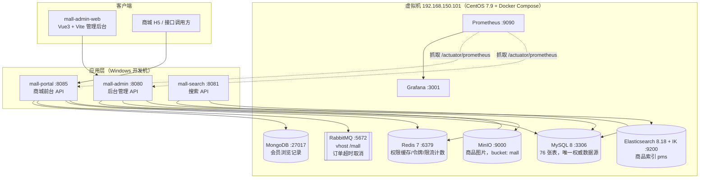
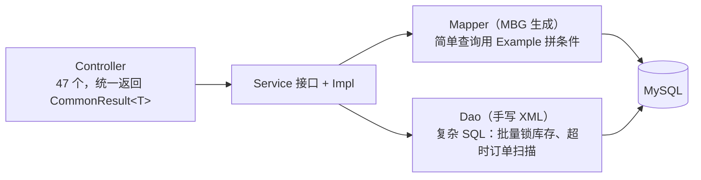
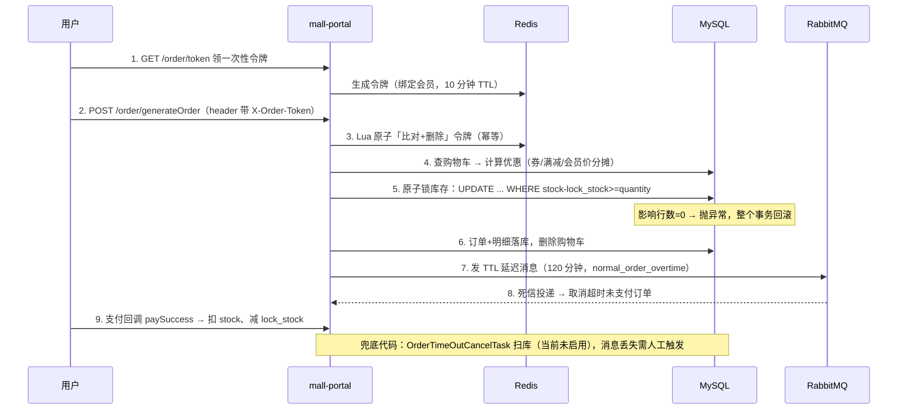
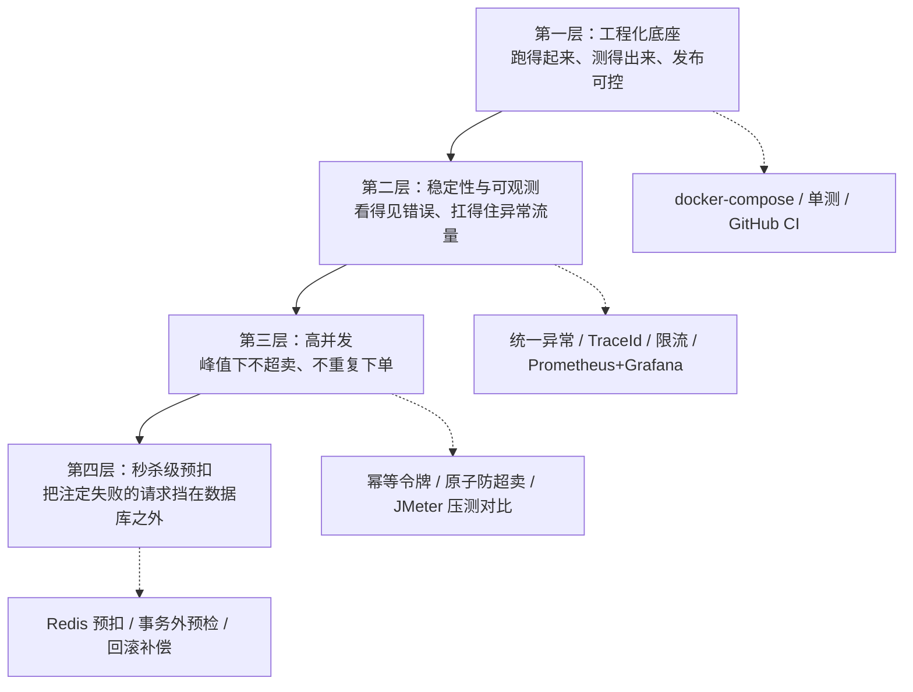
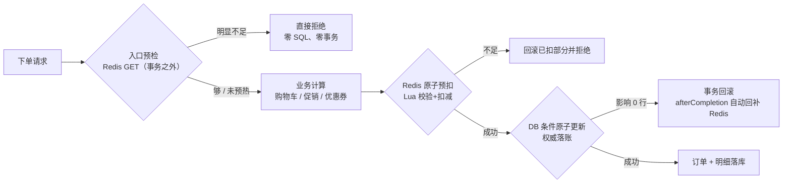

# mall 项目架构与分阶段改造说明

> 本文档是项目的完整技术说明，覆盖：整体架构 → 核心业务链路 → 四阶段改造（工程化底座 / 稳定性与可观测 / 高并发 / 秒杀级预扣）→ 压测数据 → 运行指引。
> 适合作为项目讲解（面试 / 复盘 / 二次开发接手）的唯一入口。
> 更细的分项文档见：`工程化底座方案.md`、`监控与稳定性方案.md`、`高并发改造方案.md`、`运行手册.md`。

---

## 一、项目是什么

mall 是一套**单体多模块**的电商系统（Spring Boot 3 + Java 17），业务覆盖商品、订单、营销、会员、内容五大域。它不是微服务：没有注册中心和网关，而是**按「端」拆分成三个独立部署的应用，共用同一个 MySQL 库**。

| 模块 | 角色 | 端口 | 说明 |
|---|---|---|---|
| mall-admin | 后台管理端 | 8080 | 商品/订单/营销/会员管理，31 个控制器 |
| mall-portal | 前台商城端 | 8085 | 购物车、下单、支付、会员，13 个控制器 |
| mall-search | 搜索端 | 8081 | 基于 Elasticsearch 的商品搜索 |
| mall-common / mall-security / mall-mbg | 基础库 | - | 通用组件、动态权限框架、MyBatis 逆向工程 |
| mall-demo | 示例模块 | - | 框架用法演示 |

业务域沿用国内电商经典前缀：`pms` 商品、`oms` 订单、`sms` 营销、`ums` 用户、`cms` 内容，共 **76 张表**。

技术栈：Spring Boot 3.5 / MyBatis + MBG / MySQL 8 / Redis 7 / RabbitMQ / MongoDB / Elasticsearch 8.18 + IK / MinIO / Prometheus + Grafana / JMeter。

---

## 二、整体架构

### 2.1 模块与部署拓扑



**架构特点**：

1. **按端拆分、不按域拆分**——拆的是部署单元，不是数据边界。三个应用互不调用，数据库是唯一耦合点，任何一端改表都会影响全体。
2. **多实例友好**——JWT 无状态登录、权限映射与限流计数都在 Redis，起两个实例挂 Nginx 即可横向扩。
3. **逆向工程驱动**——`mall-mbg` 由 MyBatis Generator 按 76 张表生成 model/Example/Mapper（约 6.8 万行，占全项目 79%），业务代码约 1.5 万行。

### 2.2 分层结构（每个应用内部）



---

## 三、核心业务讲解

### 3.1 商品两层模型与库存

`pms_product` 是 SPU，`pms_sku_stock` 是 SKU。库存拆成两个字段：

- `stock`：真实可售库存
- `lock_stock`：下单锁定（未支付）库存

下单只加 `lock_stock`；支付成功才真正扣 `stock`；取消/超时则反向解冻。这套「预占-确认-释放」是整个库存体系的基石。

### 3.2 交易主链路（最核心）



要点：

- **幂等在第一步就拦住**：同一令牌的第二次提交不会走到库存锁定和落库，Redis 故障时 fail-open 放行（幂等不能成为新的单点）。
- **防超卖靠一条 SQL**，见 4.3。
- **超时取消有双保险**：MQ 延迟消息 + 定时任务扫库。

### 3.3 营销叠加计算

下单时对购物车做促销计算：优惠券（领取记录状态机）、限时秒杀、满减、阶梯价、会员价可以叠加，优惠金额按商品金额占比**分摊**到每个 `order_item`（`handleCouponAmount` / `handleRealAmount`），退款时才能按分摊额精确退。

### 3.4 动态权限（设计最巧的一块）

`ums_resource` 表存「URL → 权限标识」，`DynamicAuthorizationManager` 每次请求拿路径查需要什么权限，再与 JWT 中的 `GrantedAuthority` 比对；查询结果被 `RedisCacheAspect` 缓存。运营在后台加菜单、绑角色**立即生效**，不用改代码重启。

### 3.5 搜索同步

ES 与主库是**手动同步**：`/esProduct/importAll` 全量、`/esProduct/create/{id}` 单条。商品 mapping 用 `ik_max_word` 分词（ES 镜像预装 IK 插件）。够用但没有 binlog/CDC，商品改价会短暂不一致——这是已知取舍。

---

## 四、分阶段改造

改造原则：**每层解决一类问题，不动业务语义，全部带验证**。前三层是通用能力建设，第四层针对秒杀级峰值。



### 4.1 第一层：工程化底座

| 问题 | 改造 | 验证 |
|---|---|---|
| 环境搭建靠手工 | `docker-compose.yml`：MySQL/Redis 核心服务 + profiles（mq/mongo/search/monitoring），`MYSQL_DATABASE=mall` 挂载 SQL 自动建库 | 虚拟机一键起 12 个容器，重启自动恢复 |
| `mvn package` 必失败 | pom：`skipTests` 关闭、surefire 排除依赖环境的 DAO 测试、docker-maven-plugin 默认 skip（原绑定 package 且 dockerHost 不可达） | 本地 `mvn clean install` 全绿 |
| 无测试 | 新增 Mockito 单测，修正测试目录错位 | 全量 17 用例通过 |
| 无 CI | `.github/workflows/ci.yml`：JDK17 + Maven 缓存 → 构建测试 → 归档报告 | 每次 push 自动跑，全绿 |

### 4.2 第二层：稳定性与可观测

| 问题 | 改造 | 关键点 |
|---|---|---|
| 异常处理裸奔 | `GlobalExceptionHandler` 重写：10 类异常分类处理；业务异常 WARN 不打栈；未知异常对外只返回「系统繁忙」 | 不泄漏内部信息 |
| 问题难定位 | `TraceIdFilter`：MDC 注入 traceId，回写 `X-Trace-Id` 响应头，logback 输出带 `[traceId]` | 一次请求全链路可追踪 |
| **日志明文打印登录密码** | `WebLogAspect` 重写：13 类敏感字段脱敏、2000 字截断、慢请求 >500ms WARN | 安全合规 |
| 异常流量无防护 | `@RateLimit` + 切面：Redis + Lua 原子计数（INCR+EXPIRE 一个脚本），IP/USER/GLOBAL 维度，Redis 故障 fail-open | 接入后台登录、会员登录、下单 |
| 无监控 | micrometer-prometheus + Grafana 6 面板看板（QPS/P95/错误率/JVM/Tomcat/Druid）；Druid 无官方 Micrometer 支持，手写 `DruidMetricsConfig` 注册 Gauge | 看板 provisioning 自动加载 |

### 4.3 第三层：高并发（本层重点）

**改造前两个致命缺陷**：

1. **超卖**：锁库存是「查出来 → 内存 +1 → 整行写回」，两个并发请求都能通过校验，后写覆盖先写。
2. **重复下单**：无提交令牌，连点/重放产生重复订单。

**防超卖——一条带条件的原子 UPDATE**：

```xml
<update id="lockSkuStock">
  UPDATE pms_sku_stock
  SET lock_stock = lock_stock + #{quantity}
  WHERE id = #{skuId} AND stock - lock_stock >= #{quantity}
</update>
```

判断与累加在数据库内原子完成，影响行数为 0 即库存不足 → 抛异常 → `@Transactional` 回滚整单（含已锁定的其他 SKU）。事务回滚同时保证失败请求不会误删购物车。

**幂等——一次性令牌**：

```java
// Lua：比对 + 删除一次完成，天然防并发重放
local v = redis.call('GET', key)
if v == ARGV[1] then
    redis.call('DEL', key)
    return 1
end
return 0
```

前端先 `GET /order/token` 领令牌（与会员绑定），提交时放 `X-Order-Token` 头。新增 `mall.order.idempotent-enabled` 开关、`mall.order.stock-lock-mode`（atomic/legacy）开关、`mall.rate-limit.enabled` 开关，均为压测对比服务。

**顺带修复的两个真 bug**：

1. 空购物车下单会插入 0 条订单明细 → SQL 语法错 → 入口拦截；
2. `String.format("%02d", null)` 输出字面量 `null`，订单号从 18 位变 20 位 → 兜底为 `00`。

### 4.4 第四层：秒杀级库存预扣（Redis）

**第三层留下的天花板**：防超卖靠 MySQL 条件原子更新，正确但每笔请求都要开事务、加行锁、写 undo log。秒杀场景（1000 人抢 10 件）里 990 个请求注定失败，让它们打到数据库是纯粹的浪费——既拖慢成功请求，也可能把连接池打满。

**三道闸门**：



**七个关键设计**：

| 设计 | 原因 |
|---|---|
| 预检放在**事务之外**（`precheckStock` 故意不加 `@Transactional`） | 被拒请求连事务都不开启，数据库侧 `Com_rollback` 归零 |
| 预扣用 **Lua 一次执行**「读 + 判断 + 扣减」 | 拆成 GET 与 DECRBY 两条命令会被并发穿插，照样超扣 |
| Redis 只做**拦截**，数据库仍是权威 | 预扣成功后仍执行条件原子更新，双重保护，Redis 挂了也不丢正确性 |
| 未预热 / Redis 故障 → **降级到数据库** | 返回 `NOT_PREHEATED`，功能可用性优先于性能 |
| 事务回滚用 `TransactionSynchronization.afterCompletion` 自动回补 | 下单后面的订单落库、明细插入、MQ 发送都可能抛异常，只有事务钩子能覆盖所有回滚路径 |
| 回补用 Lua「key 存在才 INCRBY」 | 直接 INCRBY 在 key 不存在时会从 0 创建，等于凭空变出库存 |
| 后台改库存后自动刷新 Redis 计数 | 否则出现「页面显示 100 件、Redis 仍是 0 件」，用户永远提示库存不足 |

**取消 / 超时关单必须回补**：`cancelOrder` 与 `cancelTimeOutOrder` 在释放数据库锁定的同时调用 `restore`，否则 Redis 可售数会只减不加，越跑越少（俗称「库存蒸发」）。

**压测对比（库存 10 件、900 请求、100 并发）**：

| 指标 | db 模式（仅数据库） | redis 模式（预扣） |
|---|---|---|
| 成功下单 | 10 | 10 |
| **事务回滚次数** | **889** | **0** |
| 数据库 SELECT | 1893 | **1012**（-47%） |
| 失败请求 P95 | 20 ms | **8 ms** |
| 平均响应 | 12 ms | **7 ms** |
| 吞吐 | 185.0 req/s | 184.6 req/s |
| 数据一致性 | 10/10，零超卖 | 10/10，零超卖，Redis 余 0 |

**诚实的结论**：

1. **省掉的是数据库工作量，不是客户端感受到的吞吐**。880 次事务回滚、881 次查询被消除，但 TPS 没有数量级提升——因为本机瓶颈在 Tomcat 线程池和单机 JMeter 客户端，不在 MySQL。
2. **失败路径快 2.5 倍**（20ms → 8ms），这对秒杀体验很关键：抢不到的请求应该「立刻告诉你没了」，而不是让用户等 200ms 看转圈。
3. **真正的价值在规模放大后**：万级并发时数据库会先被打满，而 880 个注定失败的请求被 Redis 挡掉，意味着数据库只需处理 10 笔真实订单。

**运维要点**：

```bash
# 秒杀前 / Redis 重启后：预热全部 SKU 的可售库存（overwrite=true 强制覆盖）
curl -X POST "http://localhost:8080/sku/preheat?overwrite=true" -H "Authorization: Bearer <admin-token>"

# 切换模式（默认 db，秒杀场景用 redis）
java -jar mall-portal.jar --mall.order.stock-deduct-mode=redis
```

监控口径：对比 `SELECT * FROM pms_sku_stock` 的 `stock - lock_stock` 与 Redis 的 `mall:stock:sku:{id}`，两者应相等；出现偏差时用预热接口以数据库为准重建。

### 4.5 第五层：取消订单消息的可靠性

**原来的问题**：`generateOrder` 在 `@Transactional` 方法内部直接 `convertAndSend` 延迟取消消息，带来两种错误：

1. 消息先于事务提交到达消费者，消费者按 `orderId` 查出「订单不存在或已不是待付款」，静默跳过 → 这笔订单再也不会被消息关闭；
2. 事务回滚后消息已经发出去了，等于为一笔不存在的订单安排取消。

同时取消逻辑是「先查 status=0，再改状态」，延迟消息重复投递、或消息消费与每 10 分钟的超时扫描任务并发时，两条路径都能读到 status=0，**库存会被释放两次**（`lock_stock` 变负、Redis 计数虚增）。

**改造后**：

| 问题 | 做法 |
|---|---|
| 发送时机 | `TransactionSynchronization.afterCommit()` 里发送；事务回滚则根本不发 |
| 发不出去 | 发送异常只记 `WARN`，不让 MQ 故障拖垮下单；补扫由 `OrderTimeOutCancelTask` 代码提供（该类 `@Component` 被注释、当前未启用，需人工调用 `/order/cancelTimeOutOrder`） |
| 重复消费 | 新增 `PortalOrderDao.closeUnpaidOrder`：`UPDATE oms_order SET status=4 WHERE id=? AND status=0`，**影响行数=1 才继续**释放库存/回补 Redis/退券/退积分 |
| 扫描与消息并发 | 超时扫描任务改走同一条 `closeUnpaidOrder` 幂等路径，两边只有一方能成功关闭订单 |
| 坏消息 | 消费端捕获异常并记 `ERROR`，避免默认策略无限重投堵住消费者 |

**实测验证**（新代码重启 portal 后）：

```
# 对订单 73（SKU201 lock_stock=1）投递取消消息
第一次：process orderId:73            → 订单 status=4，lock_stock 1→0
第二次（重复投递）：cancel skip orderId:73, 订单不存在或已非待付款状态
                                    → lock_stock 保持 0，没有变成 -1
```

下单路径同样验证：新建订单 967 后日志中 `send orderId:967` 出现在接口返回前（事务提交时触发），延迟队列 `mall.order.cancel.ttl` 增加 1 条待投递消息。

### 4.6 第六层：商品变更的 ES 增量同步

**原来的问题**：索引与数据库靠人工对齐——后台改完商品，要另外调 `POST /esProduct/importAll` 或 `/esProduct/create/{id}` 才会生效。实际使用中会出现两个后果：

1. 运营改完价格、库存，前台搜索仍是旧值，且没人知道要手动触发；
2. 更严重的是**下架/删除后商品仍能被搜到**——原 `create(id)` 在查不到商品时直接返回 null，不会去动索引里的旧文档，用户点进去才发现商品已下架。

**方案取舍**：

| 方案 | 结论 |
|---|---|
| admin 直接调 ES 客户端 | 否。商品保存的耗时与失败率被绑定到搜索引擎，ES 抖动一次后台就改不了商品 |
| binlog / CDC（Canal、Debezium） | 否。能覆盖所有写入来源（含直接改库），但要新增中间件与位点运维，对当前项目过重 |
| **应用层发 MQ + search 消费** | **采用**。写入只依赖 MySQL，索引延迟秒级可接受；复用已有 RabbitMQ |

**关键设计**：

| 点 | 做法与原因 |
|---|---|
| 消息只带 ID | 消费端回查数据库重建文档。重复消费、消息乱序都不会把索引写成过期数据——比「消息带全量快照」健壮得多 |
| 事务提交后发送 | 消费端是回查数据库的。若在提交前发，消费端读不到数据 → 判定为「已下架」→ 把文档删掉，商品上架了却搜不到（同一类坑在 4.5 节也踩过） |
| 查不到就删文档 | 新增 `EsProductService.sync(id)`：查得到写索引，查不到 `deleteById`。这正是原 `create(id)` 缺失的那一半逻辑 |
| JSON 消息转换器 | 默认 JDK 序列化在消费端会触发 Spring AMQP 的类白名单校验，自定义类型直接 `SecurityException` 且**发生在进入业务方法之前**，代码里的 try/catch 兜不住。两端统一换 `Jackson2JsonMessageConverter`，顺带让消息在控制台可读 |
| 队列长度上限 | `x-max-length=50000` + `x-overflow=drop-head`。search 是独立服务不一定常驻，无上限会把 broker 内存吃光；丢最老消息符合「只要最新状态」的语义 |
| 失败兜底 | 发送异常只记 `WARN`（MQ 故障不该让运营改不了商品），索引偏差由 `POST /esProduct/importAll` 全量重建兜底；单条同步失败不影响同批其它商品 |

**触发点**：商品新增、编辑、上下架、删除、审核、推荐状态、新品标记——共 7 个入口，覆盖所有会影响索引内容的写操作。

**实测验证**（admin 8080 + search 8081 均运行新代码，商品 26 = HUAWEI P20）：

```
下架：POST /product/update/publishStatus?ids=26&publishStatus=0
  admin:  send product sync: ProductSyncMessage{productIds=[26], reason='publish'}
  search: process product sync, reason:publish, ids:[26], indexed:0
  ES:     GET /pms/_doc/26 → found: false

上架：POST /product/update/publishStatus?ids=26&publishStatus=1
  search: process product sync, reason:publish, ids:[26], indexed:1
  ES:     GET /pms/_doc/26 → found: true（_version 4）

搜索接口：GET /esProduct/search/simple?keyword=HUAWEI → total 2，含刚恢复的 P20
```

队列 `mall.product.sync` 声明结果：`consumers=1, x-max-length=50000, x-overflow=drop-head`。

---

## 五、压测数据（JMeter 5.6.3 实测）

**唯一变量法**：同一个 jar，通过开关切换库存实现，其余（数据/并发/时长）完全一致。

- 数据：SKU 99 库存 100 件，9 个会员 360 条购物车，360 个预生成一次性令牌
- 负载：40 线程 × 9 循环 = 360 请求，ramp-up 5s
- 令牌预生成原因：登录是 BCrypt 校验（单次约 100ms CPU），放压测循环会打满 CPU 导致 TPS 失真

| 指标 | A 组（改造前 legacy） | B 组（改造后 atomic + 幂等） |
|---|---|---|
| 成功下单 | **359** | **100** |
| 库存 | 100 | 100 |
| **超卖** | **259 件** | **0** |
| 最终 `lock_stock` | **47**（丢失更新） | **100**（准确） |
| 失败请求 | 1 | 260（全部「库存不足」） |
| 吞吐 | 66.7 req/s | **73.5 req/s** |
| P95 | 202 ms | **178 ms** |
| 剩余购物车 | 0（全消耗） | 260（事务回滚未误删） |

**三个结论**：

1. 改造前库存 100 件卖出 359 件（超卖 2.6 倍）；改造后严格等于库存数。
2. A 组 `lock_stock` 终值 47 与订单量 359 严重对不上——「读-改-写」的丢失更新让库存账实不符，这个字段本身就是超卖的审计证据。
3. 防超卖没有用性能换：原子更新把「查 + 改」合并成一条语句，反而少了数据库往返，吞吐略升。

功能级验证：同一令牌并发 10 次 → 1 成功 9 拒绝；8 会员并发抢 1 件 → 1 成功 7 拒绝，最终 `stock=1 / lock_stock=1`。

### 5.1 秒杀限量场景：306 并发抢 10 件

模拟秒杀报名超过库存 30 倍的极端场景，验证「Redis 预扣 + DB 条件更新」双层防线。

- 数据：SKU 201（iPhone 14，秒杀价 5699），库存压到 **10 件**，9 个会员共 **306 条购物车**
- 负载：**306 线程 × 1 循环**，同一瞬间发起（无 ramp-up），每请求携带唯一幂等令牌
- 对照组：同一组数据分别跑 Redis 预扣模式与 DB 模式，唯一变量是 `mall.order.stock-deduct-mode`

| 指标 | DB 模式 | Redis 预扣模式 |
|---|---|---|
| 成功下单 | **10** | **10** |
| 失败请求 | 296 | 296 |
| **超卖** | **0** | **0** |
| 最终 `stock / lock_stock` | 10 / 10（可售 0） | 10 / 10（可售 0） |
| Redis 计数终值 | — | **0**（与 DB 可售一致） |
| 平均响应 | 53 ms | **42 ms** |
| P50 / P90 | 9 / 184 ms | **6 / 44 ms** |
| P95 | 397 ms | **313 ms** |
| 成功单平均耗时 | 465 ms | 551 ms（含事务提交） |

**结论**：

1. 两种模式都做到「库存 10 → 成交 10」，无一件超卖；Redis 计数与数据库可售库存严格一致（都是 0）。
2. 拒绝路径快了一个数量级：P50 6ms vs 9ms、P90 44ms vs 184ms。原因是被 Redis 挡掉的 295 个请求压根没进数据库事务，省掉了「开事务 + 查购物车 + 条件更新 + 回滚」的完整链路。
3. 成功单耗时反而略高（551 vs 465ms），因为 Redis 模式在入口多做了一次原子预扣，但这正是「用少量入口开销换掉 96% 无效事务」的取舍——高并发下真正稀缺的是数据库连接和行锁，不是这一次 Redis 往返。
4. 296 个失败中 295 个是「库存不足」，另 1 个是**幂等令牌重复提交拦截**（压测端重试导致同一令牌提交两次）。这不是缺陷，恰好证明防重生效：抢购场景下用户狂点「提交」也只可能成一次。

复现脚本：`scripts/bench/order-bench-seckill.jmx`（Redis 模式）与 `order-bench-db306.jmx`（DB 模式），数据准备见 `scripts/bench/README.md`。

---

## 六、运行指引

### 6.1 中间件（虚拟机一键起）

```bash
# 宿主机：vmrun 启动虚拟机后
ssh root@192.168.150.101
cd /opt/mall-infra
docker compose up -d                                  # 核心服务（MySQL/Redis）
docker compose --profile mq --profile mongo --profile search up -d   # MQ/Mongo/ES
docker compose --profile monitoring up -d             # Prometheus/Grafana
```

- MySQL `root/root`，Redis 无密码 6379，RabbitMQ `mall/mall`（vhost `/mall`），ES 9200（预装 IK），MinIO 9000（bucket `mall`）
- 注意：系统原生 mysqld 已 `systemctl disable`，避免抢占 3306；ES 需要 `vm.max_map_count=262144`（已持久化到 `/etc/sysctl.d/99-mall-es.conf`）

### 6.2 应用

```bash
mvn clean install -DskipTests        # 构建全量
java -jar mall-admin/target/mall-admin-1.0-SNAPSHOT.jar     # 8080
java -jar mall-portal/target/mall-portal-1.0-SNAPSHOT.jar   # 8085
java -jar mall-search/target/mall-search-1.0-SNAPSHOT.jar   # 8081
# 压测模式：--mall.rate-limit.enabled=false [--mall.order.stock-lock-mode=legacy --mall.order.idempotent-enabled=false]
```

前端：`mall-admin-web`（Node ≥22.12），账号 `admin/macro123`；会员 `test/123456`。

### 6.3 常用入口

| 地址 | 用途 |
|---|---|
| http://localhost:8080/swagger-ui.html | 后台 API 文档 |
| http://localhost:8085/swagger-ui.html | 前台 API 文档 |
| http://192.168.150.101:3001 | Grafana 看板（mall 文件夹，admin/admin） |
| http://192.168.150.101:9090 | Prometheus |
| http://192.168.150.101:9200 | ES 集群状态 |

---

## 七、遗留事项与下一步

| 项 | 状态 | 说明 |
|---|---|---|
| 支付宝配置 | ⚠️ 占位符 | 支付链路跑不通，需提供沙箱 appId/密钥 |
| 消息可靠性 | ✅ 已完成 | 事务提交后发送（afterCommit）+ 取消逻辑条件更新幂等 + 消费端异常兜底，见 4.5 |
| Redis 预扣库存 | ✅ 已完成 | 见 4.4，默认 `db` 模式，秒杀场景切 `--mall.order.stock-deduct-mode=redis`；上线/Redis 重启后需调预热接口 |
| ES 同步 | ✅ 已完成 | admin 事务提交后发 MQ，search 消费增量更新；查不到即摘除文档，队列带上限防堆积，见 4.6 |
| DTO 分层 | 部分完成 | 部分接口直接返回数据库实体，改表会影响 API 契约 |

## 八、提交记录

```
f673053 feat: 下单链路压测对比与 portal 监控接入
407e5c3 chore: 补齐 MQ/Mongo/ES 环境与监控看板
7c8ee66 feat: 高并发改造 - 下单幂等与防超卖
ebd1c5e feat: 第二层稳定性与可观测性改造
c6d0086 feat: 工程化底座改造 - 容器编排/单元测试/CI 流水线
3bb78be chore: import mall project baseline
```

CI：GitHub Actions，每次 push 自动构建 + 单测（当前全绿）。
