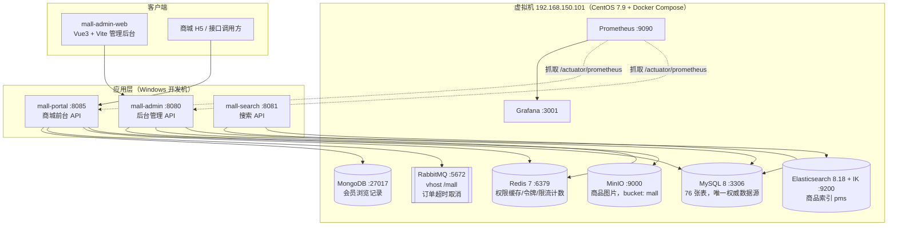
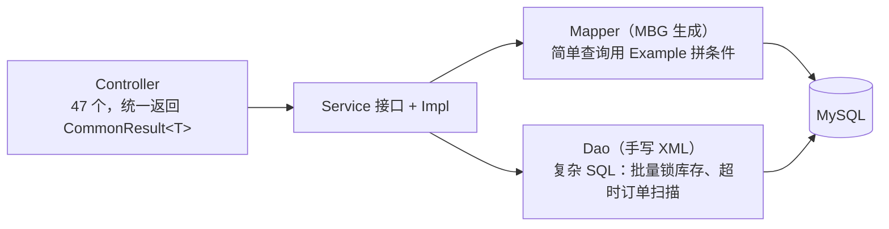
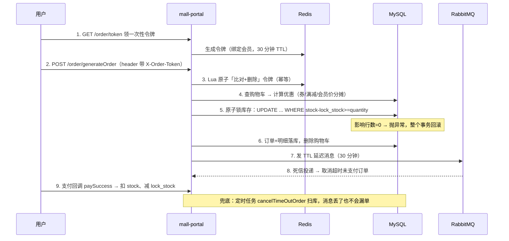
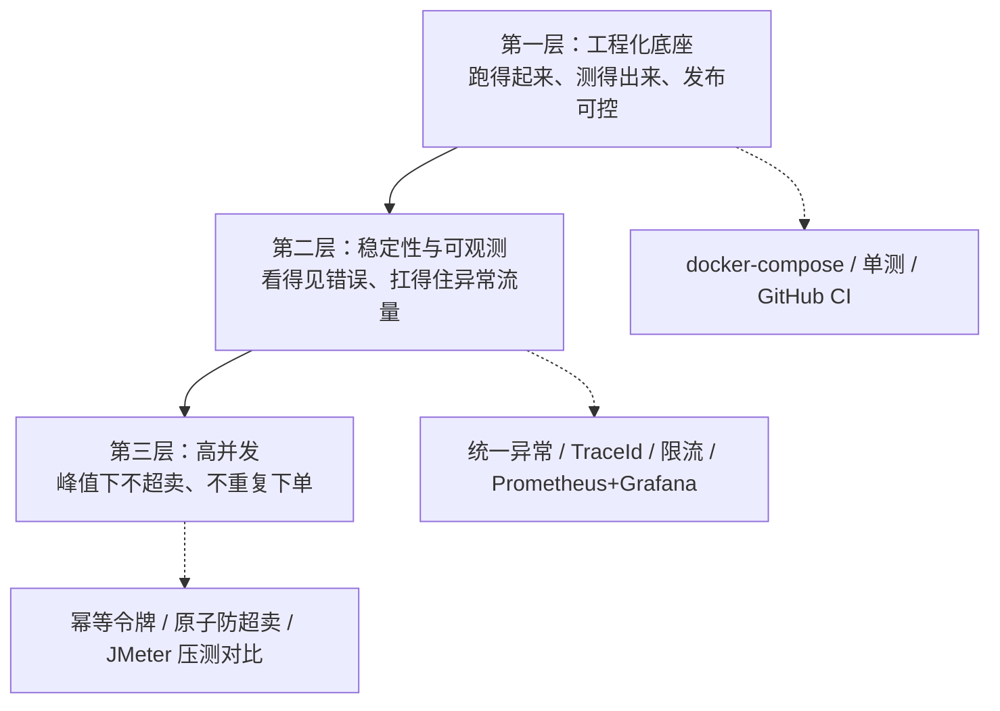

# mall 项目架构与三层改造说明

> 本文档是项目的完整技术说明，覆盖：整体架构 → 核心业务链路 → 三层工程化改造 → 压测数据 → 运行指引。
> 适合作为项目讲解（面试 / 复盘 / 二次开发接手）的唯一入口。
> 更细的分项文档见：`工程化底座方案.md`、`监控与稳定性方案.md`、`高并发改造方案.md`、`运行手册.md`。

---

## 一、项目是什么

mall 是一套**单体多模块**的电商系统（Spring Boot 3 + Java 17），业务覆盖商品、订单、营销、会员、内容五大域。它不是微服务：没有注册中心和网关，而是**按「端」拆分成三个独立部署的应用，共用同一个 MySQL 库**。

| 模块 | 角色 | 端口 | 说明 |
|---|---|---|---|
| mall-admin | 后台管理端 | 8080 | 商品/订单/营销/会员管理，31 个控制器 |
| mall-portal | 前台商城端 | 8085 | 购物车、下单、支付、会员，13 个控制器 |
| mall-search | 搜索端 | 8081 | 基于 Elasticsearch 的商品搜索 |
| mall-common / mall-security / mall-mbg | 基础库 | - | 通用组件、动态权限框架、MyBatis 逆向工程 |
| mall-demo | 示例模块 | - | 框架用法演示 |

业务域沿用国内电商经典前缀：`pms` 商品、`oms` 订单、`sms` 营销、`ums` 用户、`cms` 内容，共 **76 张表**。

技术栈：Spring Boot 3.5 / MyBatis + MBG / MySQL 8 / Redis 7 / RabbitMQ / MongoDB / Elasticsearch 8.18 + IK / MinIO / Prometheus + Grafana / JMeter。

---

## 二、整体架构

### 2.1 模块与部署拓扑



**架构特点**：

1. **按端拆分、不按域拆分**——拆的是部署单元，不是数据边界。三个应用互不调用，数据库是唯一耦合点，任何一端改表都会影响全体。
2. **多实例友好**——JWT 无状态登录、权限映射与限流计数都在 Redis，起两个实例挂 Nginx 即可横向扩。
3. **逆向工程驱动**——`mall-mbg` 由 MyBatis Generator 按 76 张表生成 model/Example/Mapper（约 6.8 万行，占全项目 79%），业务代码约 1.5 万行。

### 2.2 分层结构（每个应用内部）



---

## 三、核心业务讲解

### 3.1 商品两层模型与库存

`pms_product` 是 SPU，`pms_sku_stock` 是 SKU。库存拆成两个字段：

- `stock`：真实可售库存
- `lock_stock`：下单锁定（未支付）库存

下单只加 `lock_stock`；支付成功才真正扣 `stock`；取消/超时则反向解冻。这套「预占-确认-释放」是整个库存体系的基石。

### 3.2 交易主链路（最核心）



要点：

- **幂等在第一步就拦住**：同一令牌的第二次提交不会走到库存锁定和落库，Redis 故障时 fail-open 放行（幂等不能成为新的单点）。
- **防超卖靠一条 SQL**，见 4.3。
- **超时取消有双保险**：MQ 延迟消息 + 定时任务扫库。

### 3.3 营销叠加计算

下单时对购物车做促销计算：优惠券（领取记录状态机）、限时秒杀、满减、阶梯价、会员价可以叠加，优惠金额按商品金额占比**分摊**到每个 `order_item`（`handleCouponAmount` / `handleRealAmount`），退款时才能按分摊额精确退。

### 3.4 动态权限（设计最巧的一块）

`ums_resource` 表存「URL → 权限标识」，`DynamicAuthorizationManager` 每次请求拿路径查需要什么权限，再与 JWT 中的 `GrantedAuthority` 比对；查询结果被 `RedisCacheAspect` 缓存。运营在后台加菜单、绑角色**立即生效**，不用改代码重启。

### 3.5 搜索同步

ES 与主库是**手动同步**：`/esProduct/importAll` 全量、`/esProduct/create/{id}` 单条。商品 mapping 用 `ik_max_word` 分词（ES 镜像预装 IK 插件）。够用但没有 binlog/CDC，商品改价会短暂不一致——这是已知取舍。

---

## 四、三层工程化改造

改造原则：**每层解决一类问题，不动业务语义，全部带验证**。



### 4.1 第一层：工程化底座

| 问题 | 改造 | 验证 |
|---|---|---|
| 环境搭建靠手工 | `docker-compose.yml`：MySQL/Redis 核心服务 + profiles（mq/mongo/search/monitoring），`MYSQL_DATABASE=mall` 挂载 SQL 自动建库 | 虚拟机一键起 12 个容器，重启自动恢复 |
| `mvn package` 必失败 | pom：`skipTests` 关闭、surefire 排除依赖环境的 DAO 测试、docker-maven-plugin 默认 skip（原绑定 package 且 dockerHost 不可达） | 本地 `mvn clean install` 全绿 |
| 无测试 | 新增 Mockito 单测，修正测试目录错位 | 全量 17 用例通过 |
| 无 CI | `.github/workflows/ci.yml`：JDK17 + Maven 缓存 → 构建测试 → 归档报告 | 每次 push 自动跑，全绿 |

### 4.2 第二层：稳定性与可观测

| 问题 | 改造 | 关键点 |
|---|---|---|
| 异常处理裸奔 | `GlobalExceptionHandler` 重写：10 类异常分类处理；业务异常 WARN 不打栈；未知异常对外只返回「系统繁忙」 | 不泄漏内部信息 |
| 问题难定位 | `TraceIdFilter`：MDC 注入 traceId，回写 `X-Trace-Id` 响应头，logback 输出带 `[traceId]` | 一次请求全链路可追踪 |
| **日志明文打印登录密码** | `WebLogAspect` 重写：13 类敏感字段脱敏、2000 字截断、慢请求 >500ms WARN | 安全合规 |
| 异常流量无防护 | `@RateLimit` + 切面：Redis + Lua 原子计数（INCR+EXPIRE 一个脚本），IP/USER/GLOBAL 维度，Redis 故障 fail-open | 接入后台登录、会员登录、下单 |
| 无监控 | micrometer-prometheus + Grafana 6 面板看板（QPS/P95/错误率/JVM/Tomcat/Druid）；Druid 无官方 Micrometer 支持，手写 `DruidMetricsConfig` 注册 Gauge | 看板 provisioning 自动加载 |

### 4.3 第三层：高并发（本层重点）

**改造前两个致命缺陷**：

1. **超卖**：锁库存是「查出来 → 内存 +1 → 整行写回」，两个并发请求都能通过校验，后写覆盖先写。
2. **重复下单**：无提交令牌，连点/重放产生重复订单。

**防超卖——一条带条件的原子 UPDATE**：

```xml
<update id="lockSkuStock">
  UPDATE pms_sku_stock
  SET lock_stock = lock_stock + #{quantity}
  WHERE id = #{skuId} AND stock - lock_stock >= #{quantity}
</update>
```

判断与累加在数据库内原子完成，影响行数为 0 即库存不足 → 抛异常 → `@Transactional` 回滚整单（含已锁定的其他 SKU）。事务回滚同时保证失败请求不会误删购物车。

**幂等——一次性令牌**：

```java
// Lua：比对 + 删除一次完成，天然防并发重放
local v = redis.call('GET', key)
if v == ARGV[1] then
    redis.call('DEL', key)
    return 1
end
return 0
```

前端先 `GET /order/token` 领令牌（与会员绑定），提交时放 `X-Order-Token` 头。新增 `mall.order.idempotent-enabled` 开关、`mall.order.stock-lock-mode`（atomic/legacy）开关、`mall.rate-limit.enabled` 开关，均为压测对比服务。

**顺带修复的两个真 bug**：

1. 空购物车下单会插入 0 条订单明细 → SQL 语法错 → 入口拦截；
2. `String.format("%02d", null)` 输出字面量 `null`，订单号从 18 位变 20 位 → 兜底为 `00`。

---

## 五、压测数据（JMeter 5.6.3 实测）

**唯一变量法**：同一个 jar，通过开关切换库存实现，其余（数据/并发/时长）完全一致。

- 数据：SKU 99 库存 100 件，9 个会员 360 条购物车，360 个预生成一次性令牌
- 负载：40 线程 × 9 循环 = 360 请求，ramp-up 5s
- 令牌预生成原因：登录是 BCrypt 校验（单次约 100ms CPU），放压测循环会打满 CPU 导致 TPS 失真

| 指标 | A 组（改造前 legacy） | B 组（改造后 atomic + 幂等） |
|---|---|---|
| 成功下单 | **359** | **100** |
| 库存 | 100 | 100 |
| **超卖** | **259 件** | **0** |
| 最终 `lock_stock` | **47**（丢失更新） | **100**（准确） |
| 失败请求 | 1 | 260（全部「库存不足」） |
| 吞吐 | 66.7 req/s | **73.5 req/s** |
| P95 | 202 ms | **178 ms** |
| 剩余购物车 | 0（全消耗） | 260（事务回滚未误删） |

**三个结论**：

1. 改造前库存 100 件卖出 359 件（超卖 2.6 倍）；改造后严格等于库存数。
2. A 组 `lock_stock` 终值 47 与订单量 359 严重对不上——「读-改-写」的丢失更新让库存账实不符，这个字段本身就是超卖的审计证据。
3. 防超卖没有用性能换：原子更新把「查 + 改」合并成一条语句，反而少了数据库往返，吞吐略升。

功能级验证：同一令牌并发 10 次 → 1 成功 9 拒绝；8 会员并发抢 1 件 → 1 成功 7 拒绝，最终 `stock=1 / lock_stock=1`。

---

## 六、运行指引

### 6.1 中间件（虚拟机一键起）

```bash
# 宿主机：vmrun 启动虚拟机后
ssh root@192.168.150.101
cd /opt/mall-infra
docker compose up -d                                  # 核心服务（MySQL/Redis）
docker compose --profile mq --profile mongo --profile search up -d   # MQ/Mongo/ES
docker compose --profile monitoring up -d             # Prometheus/Grafana
```

- MySQL `root/root`，Redis 无密码 6379，RabbitMQ `mall/mall`（vhost `/mall`），ES 9200（预装 IK），MinIO 9000（bucket `mall`）
- 注意：系统原生 mysqld 已 `systemctl disable`，避免抢占 3306；ES 需要 `vm.max_map_count=262144`（已持久化到 `/etc/sysctl.d/99-mall-es.conf`）

### 6.2 应用

```bash
mvn clean install -DskipTests        # 构建全量
java -jar mall-admin/target/mall-admin-1.0-SNAPSHOT.jar     # 8080
java -jar mall-portal/target/mall-portal-1.0-SNAPSHOT.jar   # 8085
java -jar mall-search/target/mall-search-1.0-SNAPSHOT.jar   # 8081
# 压测模式：--mall.rate-limit.enabled=false [--mall.order.stock-lock-mode=legacy --mall.order.idempotent-enabled=false]
```

前端：`mall-admin-web`（Node ≥22.12），账号 `admin/macro123`；会员 `test/123456`。

### 6.3 常用入口

| 地址 | 用途 |
|---|---|
| http://localhost:8080/swagger-ui.html | 后台 API 文档 |
| http://localhost:8085/swagger-ui.html | 前台 API 文档 |
| http://192.168.150.101:3001 | Grafana 看板（mall 文件夹，admin/admin） |
| http://192.168.150.101:9090 | Prometheus |
| http://192.168.150.101:9200 | ES 集群状态 |

---

## 七、遗留事项与下一步

| 项 | 状态 | 说明 |
|---|---|---|
| 支付宝配置 | ⚠️ 占位符 | 支付链路跑不通，需提供沙箱 appId/密钥 |
| 消息可靠性 | 待做 | `generateOrder` 在事务内发延迟消息，可能先于提交被消费；应改为事务提交后发送或本地消息表 |
| Redis 预扣库存 | 待做 | 当前防超卖靠 MySQL 行锁，上限约 70-100 单/秒；秒杀级流量需 Redis 预扣 + 异步落库 |
| ES 同步 | 待升级 | 手动 importAll/create，无 binlog/CDC，商品变更会短暂不一致 |
| DTO 分层 | 部分完成 | 部分接口直接返回数据库实体，改表会影响 API 契约 |

## 八、提交记录

```
f673053 feat: 下单链路压测对比与 portal 监控接入
407e5c3 chore: 补齐 MQ/Mongo/ES 环境与监控看板
7c8ee66 feat: 高并发改造 - 下单幂等与防超卖
ebd1c5e feat: 第二层稳定性与可观测性改造
c6d0086 feat: 工程化底座改造 - 容器编排/单元测试/CI 流水线
3bb78be chore: import mall project baseline
```

CI：GitHub Actions，每次 push 自动构建 + 单测（当前全绿）。
